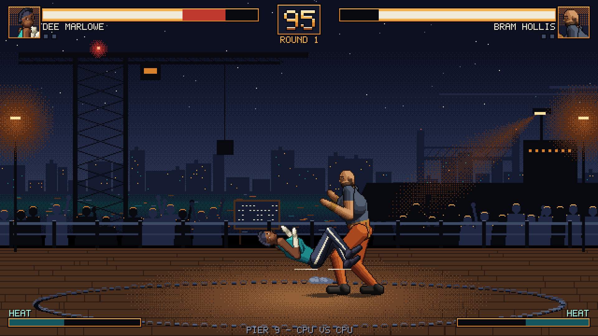

# Iron Ring

[](https://github.com/dkapusta/iron-ring/actions/workflows/ci.yml)
[](LICENSE)

An early-90s style arcade fighting game about the **Iron Ring** — an illegal, invitation-only fight-club tournament in the dying port city of Grayhaven, 1992. Big pixel-art sprites, four attack buttons, throws and specials, short explosive exchanges, built on a small, testable C++20 / SDL3 codebase. Setting and cast: [docs/design/setting.md](docs/design/setting.md).



*Above: a real frame captured with `-batchmode -demo -screenshot`: Bram Hollis's Dock Hoist slams Dee Marlowe at Pier 9. Fighters and stages are from Iron Ring Art Pack v1 ([ADR-0012](docs/adr/0012-adopting-external-art.md)); the music (a theme per venue), sound effects and announcer are generated on a model of the NES sound chip ([docs/audio.md](docs/audio.md)).*

> **Status: M1 — First playable matchup, in progress.** Dee vs Bram, data-driven fighters, throws, specials, knockdowns, best-of-3 rounds, a pixel-art HUD and a training overlay. See [ROADMAP.md](ROADMAP.md).

## Highlights

- **Fullscreen at native desktop resolution**, borderless, high-DPI aware. The game draws into a 640×360 logical canvas that is integer-scaled (or letterboxed) to the display.
- **HDR on compatible displays.** When the display reports HDR and the renderer supports scRGB output (Direct3D 11/12, Metal), impact highlights are pushed above SDR white. SDR displays get the same image, unchanged. [ADR-0005](docs/adr/0005-display-hdr-and-presentation.md)
- **Unity-style build layout** — a deliberate gimmick. The output folder looks like a Unity player: `IronRing.exe`, `UnityPlayer.dll`, `IronRing_Data/` with `globalgamemanagers`, `resources.assets`, `sharedassets0.assets`, `boot.config`, `app.info`. [ADR-0003](docs/adr/0003-unity-style-player-layout.md)
- **Asset pipeline.** `AssetPacker` bakes `Assets/` and `ProjectSettings/` into deterministic ZIP archives with Unity-like names; the runtime mounts them into a virtual file system. [ADR-0004](docs/adr/0004-asset-archives.md)
- **Deterministic simulation.** Integer-only 60 Hz combat core, no SDL dependency, snapshot checksums; started as a bit-exact port of the concept-kit prototype. [ADR-0006](docs/adr/0006-deterministic-simulation.md)
- **Fighters are data.** One `<id>.fighter.json` per fighter: frame data, boxes, throws, specials and animation timing, validated at build time. [ADR-0010](docs/adr/0010-fighter-content-format.md)
- **Dependencies via CMake FetchContent**, pinned to release tags: SDL 3.4.18, SDL3_mixer 3.2.4, miniz 3.1.2, nlohmann/json 3.12.0, doctest 2.5.3. [ADR-0002](docs/adr/0002-dependencies-via-fetchcontent.md)

## Building

Requirements: CMake ≥ 3.25, Ninja (or Visual Studio 2022), a C++20 compiler (MSVC 19.3x, GCC/MinGW-w64 ≥ 12, Clang ≥ 15), Git (FetchContent clones the dependencies on first configure). Supported platforms: **Windows and Linux**; macOS is planned later.

```sh
cmake --preset release          # first configure of a preset downloads SDL3 & friends (a few minutes)
cmake --build --preset release
ctest --preset release
```

Windows with Visual Studio: `cmake --preset vs2022` then `cmake --build --preset vs2022-release`.

**CLion on Windows (MinGW).** CLion picks up `CMakePresets.json`: enable the `debug`/`release` presets under *Settings → Build, Execution, Deployment → CMake* and select the MinGW toolchain for them (the presets use Ninja, which CLion bundles). Use the `IronRingPlayer` run configuration; set its working directory to `Build/<preset>/Player/<Config>/` if you start it with relative paths. MinGW binaries always run straight from the build folder, with no MinGW folder on PATH ([ADR-0009](docs/adr/0009-mingw-static-runtime.md)):

- Toolchains whose static runtime links cleanly (MSYS2 UCRT64, mingw-builds) get fully static binaries with no runtime DLLs.
- CLion 2026.2's bundled MinGW ships a static `libpthread.a` that can't be linked (it was built for UCRT, the toolchain uses msvcrt). CMake detects this, prints a warning, links libgcc/libstdc++ statically, and copies `libwinpthread-1.dll` next to each executable automatically.
- Override with `-DIR_MINGW_RUNTIME=STATIC|STATIC_LIBSTDCXX|SHARED` (default `AUTO`).

For fully self-contained Windows builds from CLion, add an MSYS2 UCRT64 toolchain (*Settings → Build, Execution, Deployment → Toolchains*) or use the Visual Studio toolchain.

Cross-compiling for Windows from Linux: see `cmake/toolchains/mingw-w64-x86_64.cmake` (pass a host-built `AssetPacker` via `-DIR_ASSET_PACKER=...`).

Core-only (no SDL; simulation, archives, tools and tests): `cmake --preset core && cmake --build --preset core && ctest --preset core`.

**Linux packages.** SDL3 is built from source and loads X11/Wayland/ALSA/PulseAudio at runtime, but needs their headers at build time. On Debian/Ubuntu:

```sh
sudo apt install build-essential cmake ninja-build git pkg-config \
  libx11-dev libxext-dev libxcursor-dev libxi-dev libxrandr-dev libxss-dev libxfixes-dev libxtst-dev \
  libwayland-dev libxkbcommon-dev libegl1-mesa-dev libgl1-mesa-dev libasound2-dev libpulse-dev libudev-dev libdbus-1-dev
```

The full list is in SDL's [README-linux](https://wiki.libsdl.org/SDL3/README-linux#build-dependencies).

## Running

The player lands in `Build/<preset>/Player/<Config>/`:

```text
Player/Release/
├── IronRing.exe          (IronRing.x86_64 on Linux)   launcher, ~20 lines
├── UnityPlayer.dll       (UnityPlayer.so)             engine: SDL3 + SDL3_mixer linked in
└── IronRing_Data/
    ├── app.info                 company / product
    ├── boot.config              player boot options (key=value)
    ├── globalgamemanagers       ProjectSettings/*
    ├── resources.assets         Assets/Resources/** (except audio)
    ├── resources.resource       Assets/Resources/** audio
    └── sharedassets0.assets     Assets/Data, Fighters, Stages
```

The folder is self-contained and can be zipped and copied as is. The player writes `Player.log` (previous run: `Player-prev.log`) and F12 screenshots to the per-user data folder (`%APPDATA%\dkapusta\Iron Ring\` on Windows, `~/.local/share/dkapusta/Iron Ring/` on Linux).

### Controls

| Action | Player 1 | Player 2 |
| --- | --- | --- |
| Move / jump / crouch | A D / W / S | Arrow keys |
| Light punch / heavy punch | F / G | Keypad 1 / 2 |
| Light kick / heavy kick | H / J | Keypad 3 / 0 |
| Guard | Space, or hold back | Right Shift, or hold back |
| Throw (close) / throw tech (when grabbed) | F + H (LP + LK) | Keypad 1 + 3 |
| Breakaway (50 Heat) | Guard + G + J | Guard + Keypad 2 + 0 |

Moves, written for a fighter facing right (numpad notation: 6 = forward, 2 = down, 3 = down-forward):

| Fighter | LP | HP | LK | HK | Throw | Special |
| --- | --- | --- | --- | --- | --- | --- |
| **Dee Marlowe** | Stiff Jab | Cross Counter | Shin Kick | Leg Sweep (low, knockdown) | Clinch Toss | **Rush Uppercut** — 236 + P (↓↘→ + punch) |
| **Bram Hollis** | Palm Shove | Anchor Hook | Boot Kick | Hull Breaker (low, knockdown) | Pier Toss | **Dock Hoist** — 63214 + P (→↘↓↙← + punch), command throw, can't be teched |

Tab: vs CPU → 2 players → CPU vs CPU · F2: next stage · F3: training overlay (boxes, frame data, frame advantage) · F5: new match · F1: debug overlay · F11 or Alt+Enter: fullscreen · F12: screenshot · Esc: quit. Bindings live in [`ProjectSettings/InputManager.json`](ProjectSettings/InputManager.json); fighter data in `Assets/Fighters/<Name>/<id>.fighter.json`.

### Command line

Unity-compatible names where they exist:

| Argument | Effect |
| --- | --- |
| `-screen-fullscreen 0\|1` | Windowed or fullscreen (default: fullscreen at desktop resolution) |
| `-screen-width N` / `-screen-height N` | Window size in windowed mode |
| `-logFile <path>` | Log file location |
| `-batchmode` | Headless: offscreen video, dummy audio, one tick per frame, quits after `-frames` |
| `-frames N` | Frames to run in batch mode (default 180) |
| `-screenshot <path>` | Save the final batch-mode frame as PNG |
| `-demo` | Start in CPU vs CPU mode |
| `-training` | Start with the training overlay on |
| `-stage <id>` | Start on a stage: `pier_nine`, `lantern_row`, `the_crown` |
| `-music-volume 0..1`, `-sfx-volume 0..1`, `-voice-volume 0..1` | Mix-group volumes (also in `boot.config`) |
| `-hdr auto\|on\|off`, `-vsync 0\|1`, `-presentation integer\|letterbox`, `-render-driver <name>` | Override `boot.config` |
| `-data-folder <path>` | Use another `<name>_Data` folder |
| `-assets-folder <path>` | Mount a loose `Assets/` folder over the archives (edit-and-run without repacking) |

Smoke test used by CI: `IronRing.x86_64 -batchmode -demo -screen-fullscreen 0 -screen-width 1920 -screen-height 1080 -frames 420 -screenshot shot.png`.

## Repository layout

```text
Assets/              source content: fighters, stages, effects, UI, sounds
ProjectSettings/     GameSettings, InputManager, AssetPipeline (→ globalgamemanagers)
Source/
  Core/              settings parsing (boot.config, command line)          — no SDL
  Vfs/               archive format, writer, ZIP/folder mounts, VFS         — no SDL
  Simulation/        deterministic combat core                              — no SDL
  Content/           fighter/atlas parsing and content validation           — no SDL
  Runtime/           engine module (UnityPlayer): display, HDR, audio, scenes
  Launcher/          player executable
  Tools/AssetPacker/ asset baking tool
Tests/               doctest unit tests + packer smoke test
Tools/Art/           art importer, procedural generator, art self-test (Python)
Tools/Audio/         NES sound-chip model, sound effects, venue themes, announcer (Python)
ArtSource/           editable sources of the external art (not packed)
cmake/               dependencies, compiler options, player layout, asset pipeline
docs/                ADRs, architecture, asset pipeline, research, concept art
```

## Documentation

- [ROADMAP.md](ROADMAP.md) — milestones, decisions log and open questions
- [docs/design/setting.md](docs/design/setting.md) — the Iron Ring world, roster and venues
- [AGENTS.md](AGENTS.md) — working agreements for contributors and coding agents
- [docs/architecture.md](docs/architecture.md) — module map and runtime flow
- [docs/licensing.md](docs/licensing.md) — licence choice and rationale
- [docs/asset-pipeline.md](docs/asset-pipeline.md) — adding content, archives, virtual paths
- [docs/art/asset-spec.md](docs/art/asset-spec.md) — the art contract: sizes, frames, pivots, timing, layout; [generation prompts](docs/art/generation-prompts.md)
- [docs/audio.md](docs/audio.md) — sound effects, venue themes, the announcer, mix groups and how to change them
- [docs/adr/](docs/adr/) — architecture decision records
- [docs/research/](docs/research/) — reference analysis (Fatal Fury 2) and concept-kit review

## Content and licensing

Iron Ring is free and open source under the **[zlib License](LICENSE)**, the same licence as SDL. It covers the code, documentation and the assets ([docs/licensing.md](docs/licensing.md)). Third-party components keep their own licences, listed in [THIRD_PARTY_NOTICES.md](THIRD_PARTY_NOTICES.md).

The fighters, portraits and stages are Iron Ring Art Pack v1, generated for this project and covered by its licence ([ArtSource/](ArtSource/README.md)); effects, fonts and the icon are drawn by `Tools/Art/`; all music, sound effects and announcer lines are generated by `Tools/Audio/` (the announcer's speech source is eSpeak NG, a tool: only its rendered output ships). Nothing from the *Brass Current* concept kit ships any more. No Fatal Fury (or any other franchise) artwork, characters, names, logos or audio are included; Fatal Fury 2 is used only as genre and era reference ([docs/research/fatal-fury-2.md](docs/research/fatal-fury-2.md)).

Unity and UnityPlayer are trademarks of Unity Technologies. Iron Ring is not affiliated with or endorsed by Unity, and contains no Unity code; the file naming is a stylistic choice that can be changed with one CMake variable ([ADR-0003](docs/adr/0003-unity-style-player-layout.md)).
