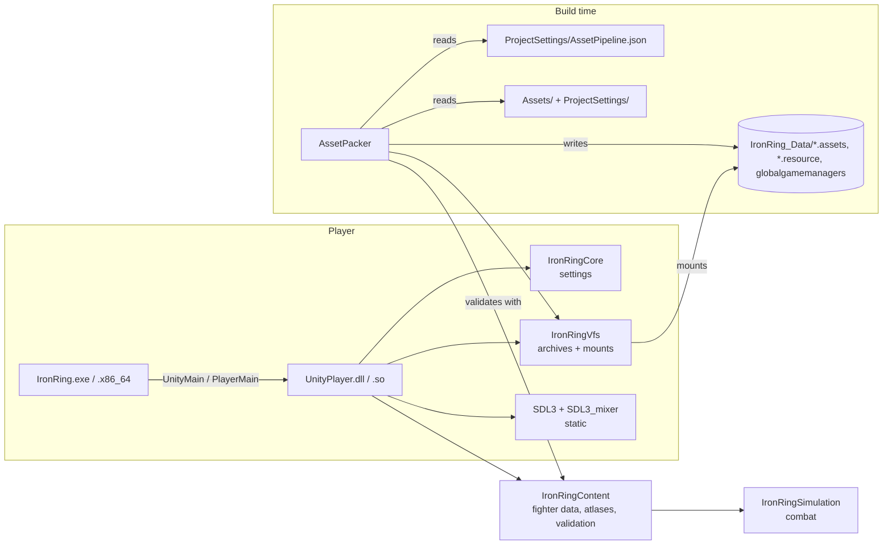

# Architecture

## Module map



Static libraries without SDL (`Core`, `Vfs`, `Simulation`, `Content`) carry everything that can be unit-tested (the simulation also holds the training rules and the deterministic training dummy, `Simulation/Training`, the CPU opponent with its five levels, `Simulation/Cpu`, and, for online play and replays, the versioned state encoding `Simulation/Serialize`, the replay format `Simulation/Replay` and the rollback session `Simulation/Rollback`, [ADR-0026](adr/0026-online-play.md)); `Content` turns JSON into the simulation's plain `FighterSpec` and checks the timing contract ([ADR-0010](adr/0010-fighter-content-format.md)), so the simulation never sees JSON; the engine module adds the platform. The launcher knows only `Public/IronRing/Player.h`.

## Engine internals (`Source/Runtime`)

| Folder | Responsibility |
| --- | --- |
| `Player/PlayerMain.cpp` | exported entry points; resolve data folder; `boot.config` + command line → `PlayerSettings`; `app.info`; `Player.log`; fatal-error dialog |
| `Player/Application` | composition root; mounts archives; owns Display, Audio, AssetLibrary, Controls, GameData and the scene stack; fixed-step loop; global keys; `-keys` scripts; screenshots |
| `Platform/Display` | fullscreen window at desktop resolution; renderer with sRGB or scRGB output, recreated on HDR changes; HDR state; logical presentation, vsync |
| `Platform/PlayerLog` | mirrors SDL logging into `Player.log` |
| `Assets/AssetLibrary` | virtual path → JSON / decoded texture (cached; released and decoded again when the renderer is recreated) |
| `Audio/AudioSystem` | SDL3_mixer mixer; mix groups (sfx pool, announcer, music) with live levels; silent fallback |
| `Game/Scene`, `Game/SceneStack` | scene interface (`handleEvent`, `handleMenu`, `fixedUpdate`, `render`, `onEnter`, `opaque`); the stack applies push/pop/replace between calls, with fades ([ADR-0015](adr/0015-front-end-scene-stack.md)) |
| `Game/Services`, `Game/GameData` | what scenes share: assets, audio, display, controls, settings, prefs; fonts, sounds, themes, stages and the roster, loaded once |
| `Game/TitleScene`, `CharacterSelectScene`, `StageSelectScene`, `OptionsScene`, `FightMenuScene` | the front end: title + attract demo, roster grid, venue picker, options (live, saved to `prefs.cfg`), pause / post-match menu |
| `Game/MenuView` | shared menu behaviour and drawing over `Core/Menu` |
| `Game/ArcadeScene` | an arcade run: versus card, the fight, continue countdown, game over, ending (`content::ArcadeRun`) |
| `Game/FightScene` | versus screen for a `FightSetup`; the `Camera` (`Core/Camera.h`) follows the fighters on wide stages (fighters, stage, control, training); `Match` + views + effects + HUD + overlay; events → sounds |
| `Game/FighterView` | simulation state → animation frame (and the held opponent's pose during throws) |
| `Game/StageView` | a flat stage, or layers with parallax, drift and animation for a camera position; the crowd's excitement (raised by hits, throws, K.O.s) |
| `Game/Effects` | short sprite effects spawned from `StepEvents`, HDR-boosted |
| `Game/Hud` | health, Heat, timer, portraits, win markers, round banners, from `hud_layout.json`; combo counter and COUNTER / BREAKAWAY callouts |
| `Game/TrainingOverlay` | F3: hit/hurt boxes (per move phase), move frame data, frame advantage |
| `Game/InputDisplay` | training: both players' recent inputs (ticks, numpad direction, buttons) |
| `Game/Controls` | keyboard and gamepads → simulation input bits (edge latch between ticks) and menu actions; bindings from `Core/InputBindings` (per player, per pad device) |
| `Game/ControlsScene`, `Game/MoveListScene` | Options → Controls remapping; the pause menu's move list |
| `Render/SpriteSheet`, `Render/BitmapFont`, `Render/Ui` | atlas frames drawn at their pivots (flippable); monospaced bitmap text; palette colours, frames, word wrap |

## Startup sequence

1. Launcher calls `UnityMain` (Windows) or `PlayerMain`.
2. Command line is probed for `-data-folder`; default `<exe dir>/IronRing_Data`.
3. `app.info` gives company/product → per-user folder.
4. `PlayerSettings` = defaults ← `boot.config` ← `prefs.cfg` (skipped in batch mode) ← command line. Unknown entries become log warnings, never errors.
5. `Player.log` opens (previous run rotated to `Player-prev.log`).
6. `Application`: `-batchmode` selects offscreen video and dummy audio → `SDL_Init(VIDEO)` → mount every archive (sorted), then `-assets-folder` → read `ProjectSettings/GameSettings.json` → `Display` → `AudioSystem` → `AssetLibrary` → `Controls` (opens the gamepad subsystem) → `GameData` → the title scene, plus a fight on top for `-demo`/`-training`/`-stage`, or the screen named by `-scene`.
7. Main loop: poll events (→ global keys, the top scene, `Controls` → menu actions) → accumulate time (cap 250 ms) → the stack's `fixedUpdate()` per 1/60 s → `render()` (from the topmost opaque scene up, then the fade) → present. Batch mode runs one tick per frame and exits after `-frames`, optionally saving the last frame. The player quits when the stack empties or the title's Quit is chosen.

Any exception during setup is logged as `Fatal:` and shown in a message box (except in batch mode); the process exits with code 1.

## Frame anatomy

```text
fixedUpdate (60 Hz)                         render (display rate)
  Controls.sample(p1, p2 | CPU | dummy)       clear → stage → fighters (z by attacker)
  Match.step(inputs) → MatchStep              → effects (colour scale = HDR boost)
  events → AudioSystem.play(...), Effects     → HUD → [training overlay] → [debug overlay] → [capture] → present
```

## Conventions that cross modules

- **Coordinates:** simulation in 1/256 logical pixels, origin at stage left, y up from the floor; rendering in 640×360 logical pixels, y down, floor at 316.
- **Virtual paths:** `Assets/`-relative (`Stages/...`, `Resources/...`) or `ProjectSettings/...`.
- **Names from CMake:** `IR_VERSION_STRING`, `IR_COMPANY_NAME`, `IR_PRODUCT_DISPLAY_NAME`, `IR_DATA_DIR_NAME`, `IR_PLAYER_LIBRARY_NAME` are compile definitions of the engine.
