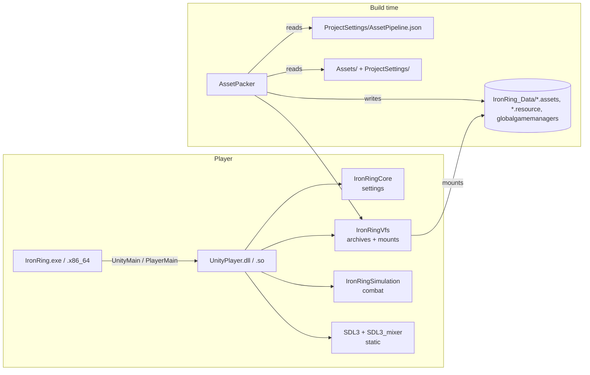

# Architecture

## Module map



Static libraries without SDL (`Core`, `Vfs`, `Simulation`) carry everything that can be unit-tested; the engine module adds the platform. The launcher knows only `Public/IronRing/Player.h`.

## Engine internals (`Source/Runtime`)

| Folder | Responsibility |
| --- | --- |
| `Player/PlayerMain.cpp` | exported entry points; resolve data folder; `boot.config` + command line → `PlayerSettings`; `app.info`; `Player.log`; fatal-error dialog |
| `Player/Application` | composition root; mounts archives; owns Display, Audio, AssetLibrary, Scene; fixed-step loop; F-key handling; screenshots |
| `Platform/Display` | fullscreen window at desktop resolution; renderer with sRGB or scRGB output; HDR state; logical presentation |
| `Platform/PlayerLog` | mirrors SDL logging into `Player.log` |
| `Assets/AssetLibrary` | virtual path → JSON / decoded texture (cached) |
| `Audio/AudioSystem` | SDL3_mixer mixer; one-shot SFX by id; silent fallback |
| `Game/Scene` | scene interface (`handleEvent`, `fixedUpdate`, `render`, `status`) |
| `Game/FightScene` | placeholder versus screen: simulation + atlases + HUD + events → sounds |
| `Game/InputMapper` | keyboard → simulation input bits, edge latch between ticks |
| `Game/SpriteAtlas` | atlas JSON (measured frames or uniform grid) |

## Startup sequence

1. Launcher calls `UnityMain` (Windows) or `PlayerMain`.
2. Command line is probed for `-data-folder`; default `<exe dir>/IronRing_Data`.
3. `PlayerSettings` = defaults ← `boot.config` ← command line. Unknown entries become log warnings, never errors.
4. `app.info` gives company/product → per-user folder → `Player.log` (previous run rotated to `Player-prev.log`).
5. `Application`: `-batchmode` selects offscreen video and dummy audio → `SDL_Init(VIDEO)` → mount every archive (sorted), then `-assets-folder` → read `ProjectSettings/GameSettings.json` → `Display` → `AudioSystem` → `AssetLibrary` → `FightScene`.
6. Main loop: poll events → accumulate time (cap 250 ms) → `fixedUpdate()` per 1/60 s → `render()` → present. Batch mode runs one tick per frame and exits after `-frames`, optionally saving the last frame.

Any exception during setup is logged as `Fatal:` and shown in a message box (except in batch mode); the process exits with code 1.

## Frame anatomy

```text
fixedUpdate (60 Hz)                         render (display rate)
  InputMapper.sample(p1, p2 | CPU)            clear → stage → fighters (z by attacker)
  Match.step(inputs) → StepEvents             → effect (colour scale = HDR boost)
  events → AudioSystem.play(...)              → HUD → [overlay] → [capture] → present
```

## Conventions that cross modules

- **Coordinates:** simulation in 1/256 logical pixels, origin at stage left, y up from the floor; rendering in 640×360 logical pixels, y down, floor at 316.
- **Virtual paths:** `Assets/`-relative (`Stages/...`, `Resources/...`) or `ProjectSettings/...`.
- **Names from CMake:** `IR_VERSION_STRING`, `IR_COMPANY_NAME`, `IR_PRODUCT_DISPLAY_NAME`, `IR_DATA_DIR_NAME`, `IR_PLAYER_LIBRARY_NAME` are compile definitions of the engine.
